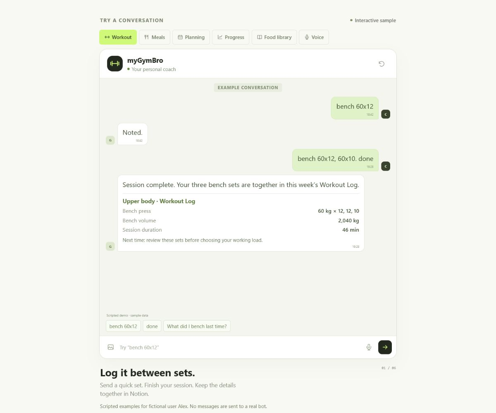
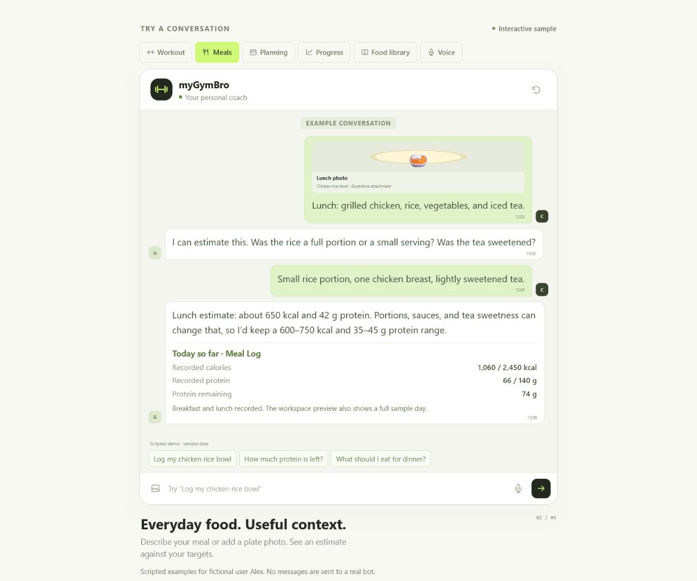
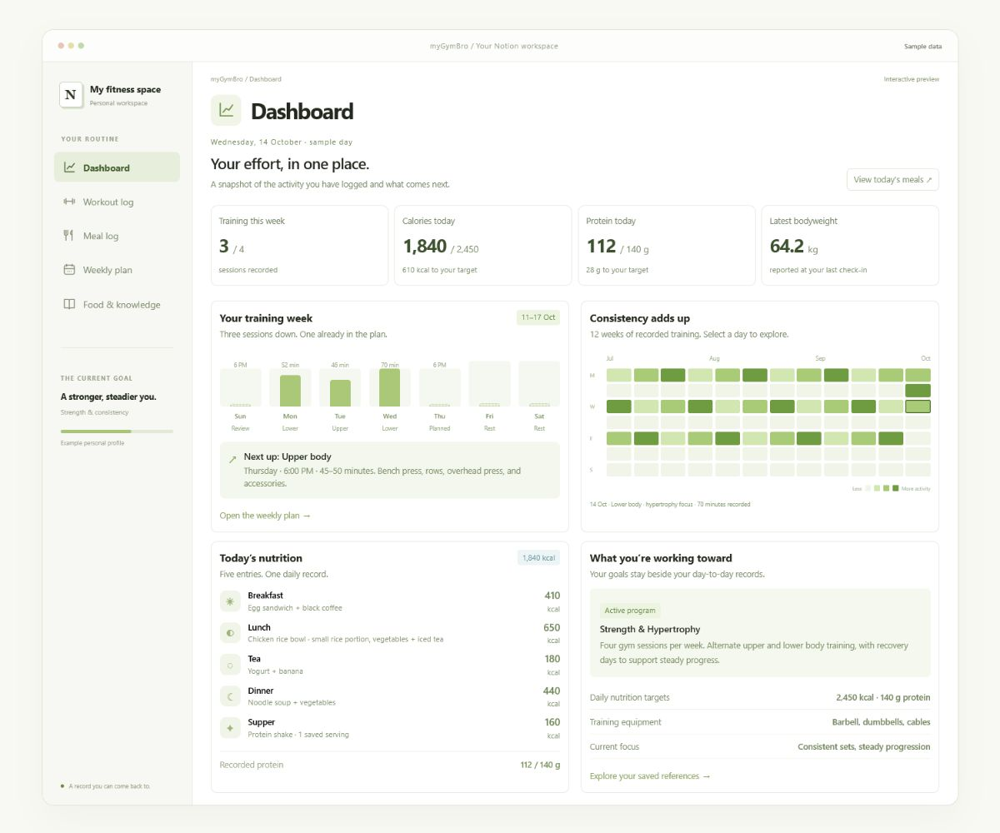
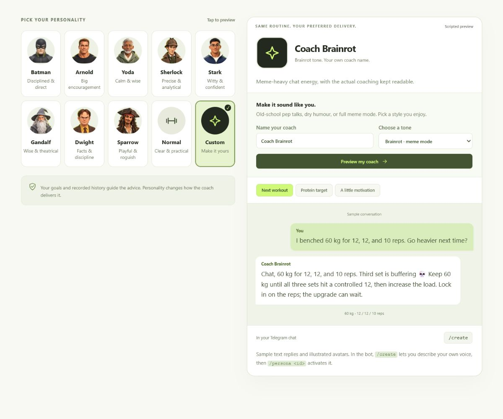

# myGymBro: Your fitness coach in Telegram

**Log it in chat. Know your next step.**

Send a set between rests, photograph lunch, or ask what to train today. myGymBro
organizes your workouts and meals in Notion, then uses your history, goals, and
preferences to guide your next session or food choice.

Run your own coach: **one person, one Telegram bot, one private Notion workspace.**

> **Hurray for free users!** Gemini offers a [free API tier](https://ai.google.dev/gemini-api/docs/pricing)
> on eligible models within quotas. Try it with fictional data: unpaid-service
> [data terms](https://ai.google.dev/gemini-api/terms) restrict personal, sensitive,
> and confidential information. See [setup and provider choices](./docs/getting-started.md).

[Get started](#quickstart-local) · [Commands](#commands) · [Privacy](./docs/privacy.md)

## A quick look

Fictional sample data, scripted replies, and an illustrative Notion-style workspace.

| **Log between sets** | **Understand your meals** |
|---|---|
|  |  |
| **See your history together** | **Choose your coaching voice** |
|  |  |

## What you get

- **Less workout admin.** Send `bench 60x12`, then `done` to save your session.
- **Nutrition in context.** Estimate meals, track targets, and reuse saved Food Library values.
- **Plans that fit you.** Use your goals, equipment, schedule, and recorded training history.
- **Progress you can review.** Weekly and monthly report cards turn logged workouts into trends.
- **Your kind of coach.** Choose a character or create a custom voice, including Brainrot.
- **An organized fitness history.** `/setup` builds your Notion logs, goals, libraries, and dashboard.

Voice notes, Google Calendar, and scheduled check-ins are optional and need configuration.
Meal estimates are approximate; coaching supports strength training, muscle growth, and general fitness.

## Quickstart (local)

You need Node.js 22+, Telegram, and a Claude, Gemini, or OpenAI credential.
Connect Notion to save workouts and meals.

[Follow the beginner setup guide](./docs/getting-started.md) for credentials, installation,
your first chat, and Notion setup. No Git experience needed.

## Commands

Try `/today` for a session, `/plan` for the week, `/report` for progress, or
`/foodlib` for saved foods. Ordinary messages and meal photos work too.

[All commands and examples](./docs/commands.md) · [Features in depth](./docs/capabilities.md)

## Hosting options

Start on your computer; it must stay awake, online, and running the bot.
Use your own cloud account if you want your coach available while your computer is off.
Only one running copy should use a bot token.

[Hosting guide](./docs/deployment.md) · [Configuration](./docs/configuration.md)

## Your data and running costs

myGymBro has no subscription fee. AI usage beyond eligible Gemini free-tier limits,
other providers, cloud hosting, and API transcription can cost money.
OpenAI API billing is separate from a ChatGPT subscription.

Set `ALLOWED_TELEGRAM_IDS` to your own ID. Keep your `.env`, profile, credentials,
and Notion workspace private. Messages and relevant records go through Telegram and
your selected AI provider; report charts use QuickChart. Local files are not encrypted
by the app, and `/new` does not erase records held by other services.

[Privacy and data controls](./docs/privacy.md) · [Security policy](./SECURITY.md)

AI can make mistakes. This is fitness coaching, not medical care; seek a qualified
professional for pain, injuries, or medical concerns.

## Help and feedback

[Setup and FAQ](./docs/getting-started.md) ·
[Report a bug](https://github.com/CalvinCheeCH/myGymBro/issues/new?template=bug_report.md) ·
[Suggest an improvement](https://github.com/CalvinCheeCH/myGymBro/issues/new?template=feature_request.md) ·
[Contribute](./CONTRIBUTING.md)

## License and credits

[MIT](./LICENSE). Built from [Oak](https://github.com/FrancescoCoding/Oak) by
FrancescoCoding (MIT). Exercise data and demonstration images come from
[free-exercise-db](https://github.com/yuhonas/free-exercise-db) (The Unlicense).
Local voice transcription uses [Whisper](https://github.com/openai/whisper) (MIT)
through [Transformers.js](https://github.com/huggingface/transformers.js) (Apache-2.0).
