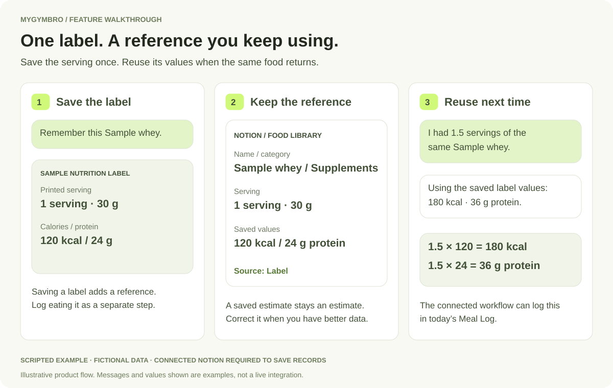
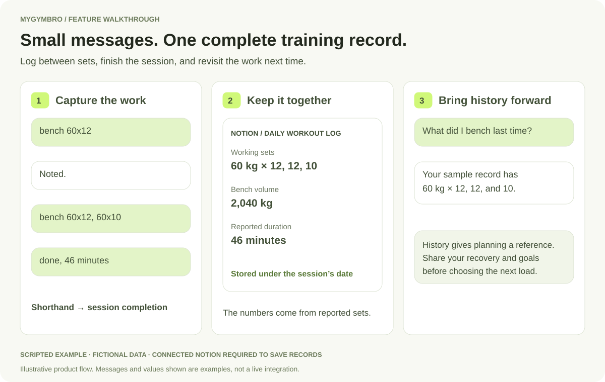
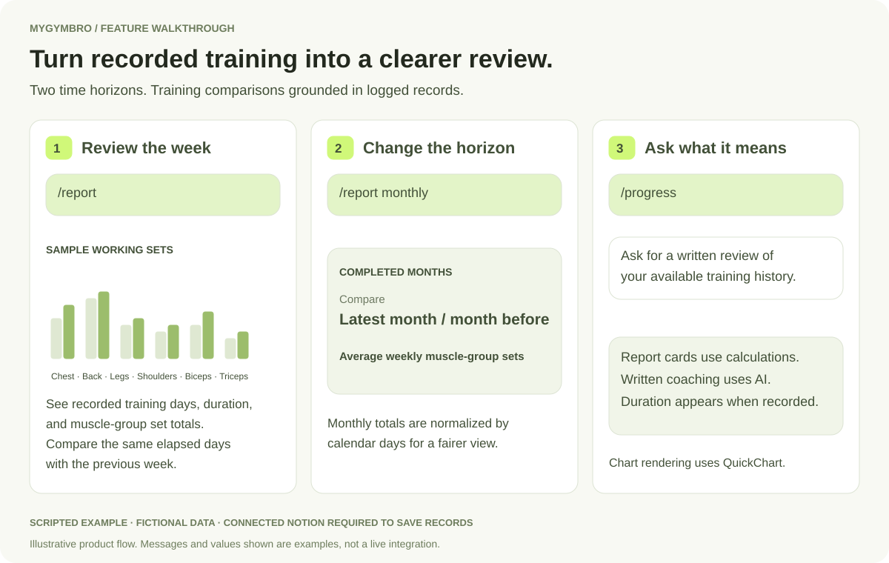
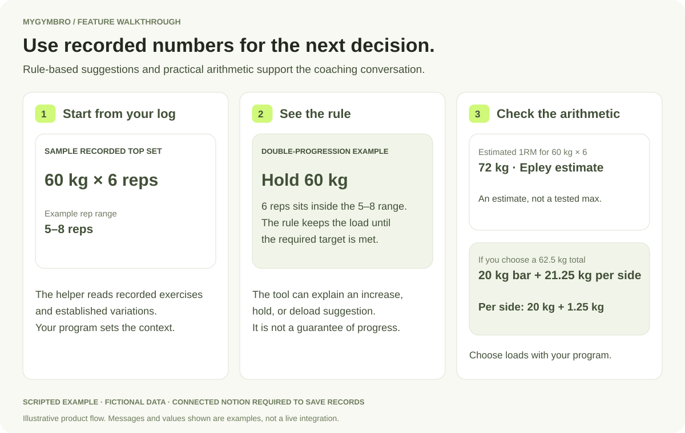
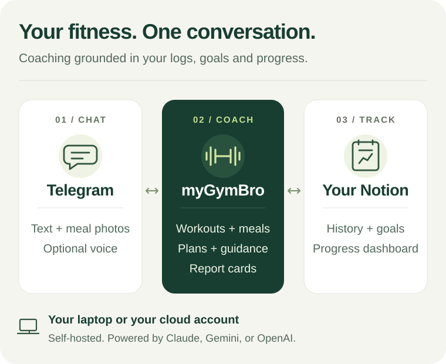

# myGymBro: Your fitness coach in Telegram

[](https://github.com/CalvinCheeCH/myGymBro/actions)
[](./LICENSE)
[](https://nodejs.org)

**Log it in chat. Know your next step.**

Send a set between rests, photograph lunch, or ask what to train today. myGymBro turns
those conversations into organized workout and meal records, then uses your saved
history, goals, equipment, and nutrition targets to guide what comes next.

Your records live in a Notion workspace the coach builds for you. Choose a coaching
voice that fits you, from direct and practical to playful, and build a routine around
strength training, muscle growth, or general fitness.

**You run your own coach:** one person, one Telegram bot, and one private Notion
workspace per deployment. Bring your own AI account; provider and hosting charges
may apply. Start on your computer, then choose cloud hosting if you need it available
while your computer is off.

> **Hurray for free users!** Gemini offers a [free API tier](https://ai.google.dev/gemini-api/docs/pricing)
> for eligible models, so you can try myGymBro with sample data and no AI usage
> charges within Google's quotas. **[Read the free-tier privacy warning first](#gemini-free-tier-privacy-warning).**

[Get started](#quickstart-local) · [See all commands](#commands) · [Understand your data](./docs/privacy.md)

## Less tracking friction, more useful history

<table width="100%">
  <thead>
    <tr>
      <th width="50%">Log between sets</th>
      <th width="50%">Understand your meals</th>
    </tr>
  </thead>
  <tbody>
    <tr>
      <td width="50%" valign="top">Send <code>bench 60x12</code>, say <code>done</code>, and keep your session together.</td>
      <td width="50%" valign="top">Send a photo, clarify portions, and see estimated calories and protein against your targets.</td>
    </tr>
    <tr>
      <td width="50%" align="center"><a href="./docs/assets/showcase/workout.jpg"></a></td>
      <td width="50%" align="center"><a href="./docs/assets/showcase/nutrition.jpg"></a></td>
    </tr>
  </tbody>
</table>

<details>
<summary><strong>See your organized workspace and choose your coach's voice</strong></summary>

See your training consistency, nutrition totals, goals, and next planned session
together. The coach can read your saved history when you ask what to adjust.


Choose a character or describe your own written style, from calm encouragement to
Brainrot. The voice changes; the same coaching and safety rules still apply.


</details>

These screenshots show scripted conversations and fictional records. The Notion-style
layout is illustrative; the preview does not connect to Telegram, Notion, or an AI provider.

## Before you start: choose where your coach runs

**You run your own copy of myGymBro.** It needs an internet-connected computer or cloud
service to stay available. Downloading the project alone does not start the coach.

| Choose | What you need | When your coach is available | Setup today |
|---|---|---|---|
| **Your laptop or desktop** | Your computer and Node.js; no server or cloud account | While the computer is awake, online, and the bot is running | [Beginner local setup](#quickstart-local) below; no Git knowledge needed |
| **Your own cloud account** | A hosting account, your credentials, and a hosting budget | While the cloud service is running; your laptop can be off | [Cloud hosting guide](./docs/deployment.md#cloud-hosting-without-a-laptop); currently needs technical configuration |

**Start on your laptop to try it. Choose cloud hosting if you want it available while
your laptop is off.** Closing the bot's terminal window, putting your computer to sleep,
or shutting it down stops local coaching and reminders. Docker on your laptop still
requires the laptop to stay on.

Cloud hosting and AI usage can cost money. You use your own accounts and keep control
of your deployment. See [hosting options](#hosting-options) for the current paths.

> Coaching only. This is not a doctor or a registered dietitian. It will tell you to see a
> professional for injuries, pain, or medical concerns. AI can make mistakes, and meal
> estimates are approximate.

## Highlights

Less manual tracking, clearer next steps: connect your workouts, nutrition, plans, and
progress through a conversation in Telegram.

- **Coaching built around you.** Get today's session with `/today` or a weekly plan with
  `/plan`, using your goals, equipment, schedule, reported recovery, and recorded training
  history to guide the recommendations.
- **Log between sets.** Send shorthand like `bench 60x12` while you rest. Supported quick
  logs get a brief acknowledgement; say `done` to organize your sets, reps, and loads into
  a session record in Notion.
- **Know where your nutrition stands.** Describe a meal or send a photo for calorie and
  protein estimates, then see your logged intake against your daily targets. Ask for
  practical food and portion guidance that fits your goals.
- **Repeat foods take less effort.** Save nutrition labels or familiar meals in your Food
  Library. Future logs reuse saved values and scale them to your reported servings.
  Browse your saved foods with `/foodlib`.
- **A clearer next weight to lift.** Use recorded lifts for rule-based progression and
  deload suggestions. Ask for an estimated one-rep max or a barbell plate calculation
  when you need practical numbers for your next session.
- **Exercise guidance for your equipment.** Find movements by muscle group or equipment,
  with instructions and demonstration images. Get alternatives when equipment changes,
  while keeping established exercise variations consistent across plans.
- **Your coach, your style.** Choose a plain coach or a character with `/persona`, or
  describe your own written coaching voice with `/create`. The personality changes the
  delivery while keeping the same coaching rules.
- **See progress and what to adjust.** Use `/report` for the weekly card and
  `/report monthly` for the monthly comparison, or `/progress` for a written
  review. Connect logged workload, lift trends, nutrition coverage,
  and body measurements with a concrete next priority. Session duration appears
  as a weekly line chart when duration was recorded with each workout.
- **Your fitness history, organized.** `/setup` builds your Notion workspace with
  workouts, meals, programs, goals, body measurements, and reference material. A dashboard
  and training heatmap make your records easier to revisit and use for future planning.
  Five main pages keep navigation simple: Dashboard, Workout Log, Meal Log,
  Weekly Plan, and Food & Knowledge. Daily nutrition rings appear above the meal
  history and on Dashboard; new weekly plans appear first on one scrollable page.
  Native Notion cards, segmented progress rings, training bars, and an activity
  grid keep your overview editable, with no dashboard images to replace.
- **Give your routine a regular nudge.** With scheduling configured, receive daily
  check-ins and weekly reviews. Connect Google Calendar to plan around your commitments
  and put training sessions on your calendar with phone reminders.

Workout and meal records require connected Notion. Voice notes are optional when
transcription is enabled, and Google Calendar is an optional integration. Scheduled
check-ins depend on your hosting and scheduler setup.

Coaching starts in English and uses the goals, equipment, diet, and schedule you share.

## Built on Oak. More ways to make your history useful.

Oak provides the Telegram coaching foundation, including Notion, Calendar, voice,
exercise lookup, and character personalities. myGymBro adds reusable food records,
structured nutrition tracking, easier set-by-set logging, visual training reviews,
and explicit training calculations. It also extends exercise references, coach
customization, and AI-provider choices.

The additions below are compared with [Oak's published source](https://github.com/FrancescoCoding/Oak/tree/b2d321549ce3ac2a49d0259a039a90352befc034).
The examples are scripted and fictional. Try the four step-by-step stories in the
[interactive feature walkthroughs](./showcase/README.md#feature-walkthroughs).

## Food Library: stop estimating the same food twice

**Your usual foods become reusable references, so the next meal starts with saved
serving values instead of another guess.** A protein powder, packaged breakfast,
or familiar homemade meal can keep its serving basis and source beside its numbers.



**Save once.** Send a readable nutrition label and say “remember this.” In this
example, Sample whey provides **120 kcal and 24 g protein per 30 g serving**. The
coach can save the name, serving, calories, protein, source, and category in Notion.
Saving a reference does not mean you have eaten it and does not itself add a meal.

**Reuse it later.** Say “I had 1.5 servings of the same Sample whey.” The saved
reference gives **180 kcal and 36 g protein** for that amount. The connected meal
workflow can record it in today's Meal Log using the saved values. If the food or
serving is unclear, the coach asks for clarification.

**Keep the source visible.** Label, Manual, and Estimate entries remain distinguishable.
A saved estimate is still an estimate. You can correct serving values for future
lookups; previous meal records keep the values saved with them.

Browse with <code>/foodlib</code>, which currently shows up to 50 foods alphabetically.
It uses your selected AI provider to format the lookup. Several food labels can also
be sent in one album with a caption identifying each item.

**The payoff:** less repeated nutrition entry, a consistent reference for repeat foods,
and serving-based logging you can check yourself. Connected Notion is required to
save and reuse the records.

## Between-set messages become a complete session

**Keep lifting while the details build up.** Send short sets, correct a value when
needed, then say <code>done</code> to finalize the session. The bot keeps
your pending sets together before saving the completed session into your dated Notion record.



The example contains three bench sets at **60 kg × 12, 12, and 10**, giving
**2,040 kg of bench volume**. Its 46-minute duration is explicitly reported in the
message. Multiple sessions on the same date can stay in separate sections of one
daily page, with later additions merged into that day's record.

Next time, ask “What did I bench last time?” Your recorded sets give the coach a
reference for the next conversation. This extends Oak's complete-session logging
with a workflow designed for the pauses between sets.

## Training reviews you can see

**Turn logged work into a comparison you can read at a glance.** Use <code>/report</code>
for the weekly training card or <code>/report monthly</code> for a completed-month comparison.



The weekly card brings together recorded training days, session duration when
available, and muscle-group working sets against the same elapsed days last week.
Monthly cards compare the latest completed month with the preceding month using
average weekly set totals, so different month lengths do not dominate the comparison.

Report commands calculate their training summaries without an AI call. Charts are
rendered through QuickChart. Ask <code>/progress</code> separately for an AI-written
review of your available records, including broader context when you have logged it.

## Training math with a reason behind the number

**Ask for the calculation behind a decision.** The coach can use rule-based load
suggestions, an estimated one-rep max, or a plate breakdown based on recorded lifts.



For example, **60 kg × 6 reps** sits inside an illustrative 5–8 rep range, so that
double-progression rule holds the load. Epley's formula estimates a **72 kg one-rep
max** for the same set. If you choose a **62.5 kg** barbell total, a 20 kg bar needs
**20 kg + 1.25 kg per side**.

These are calculation examples. Your program, technique, reported recovery, and
limitations still guide training decisions. Suggestions can explain an increase,
hold, or deload; estimates do not promise future performance.

## More additions to explore

| What becomes possible | An example to try | What myGymBro adds or extends |
|---|---|---|
| **See a whole day's nutrition** | Log breakfast and dinner, then ask how much protein remains. | Daily Meal Log records and recorded totals against your stated targets. Meal photos remain estimates. |
| **Keep your training vocabulary** | Ask the coach to keep using your familiar chest-supported row variation. | A persistent Notion Exercise Library of performed variations, alongside the inherited exercise lookup. |
| **See consistency build** | Open Training Calendar after logging sessions. | A workout heatmap and dashboard context grounded in recorded dates, meals, and saved plans. |
| **Make the delivery yours** | Use <code>/persona</code>, or <code>/create</code> to describe a dry-humour, supportive, or Brainrot voice. | In-chat selection and saved custom written voices. Oak's nine built-in characters remain part of the foundation. |
| **Choose your AI account** | Select Gemini, OpenAI, or Claude during setup. | Gemini and OpenAI engine options alongside Oak's Claude path. Provider credentials, terms, and usage limits apply. |
| **Keep photos and corrections in context** | Send two food labels in an album with a mapping caption, or reply to the meal you are correcting. | Grouped album context and quoted-message context for the agent. It can ask when the mapping is unclear. |
| **Clear a training cycle deliberately** | Use <code>/resetdata</code> to inspect the preview before confirming. | A guarded reset of tracked fitness records and weekly plans while retaining food/exercise libraries and references. |
| **Explore before connecting accounts** | Walk through the Food Library, workout, report, and training-math stories. | A scripted interactive product demonstration using fictional data; it does not run the bot. |

## Security and privacy

Use one deployment and one private Notion workspace per person. Set
`ALLOWED_TELEGRAM_IDS` to your own numeric ID and, if used, the same `OWNER_CHAT_ID`.
The bot rejects strangers and group chats; the shared profile is not tenant-isolated.

- Keep `.env`, your profile, custom voices, training imports, OAuth tokens, runtime
  records, backups, deployment parameters, and Terraform state private. Git, Docker,
  and Cloud Build exclusions cover these local files; already-tracked files and old
  commits still require review.
- Keep `RUN_LOG_PERSONAL_DATA=false` (the default). New usage metrics omit chat IDs,
  usernames, session IDs, and reply samples. Old logs remain private and are not
  deleted automatically.
- Local polling needs no public webhook. Do not forward ports 8080 or 9130 from your
  router. Docker publishes the optional health port on localhost only. Public webhook
  deployments require HTTPS, a cron secret of at least 32 characters, platform-level
  abuse protection, spending alerts, and carefully restricted storage.

Publishing source on GitHub does not deploy the bot or expose your computer by itself.
It also does not make cloud hosting immune to DDoS or guarantee that all sensitive
data has been found. Messages and relevant records go to your selected AI provider;
reports send chart data to QuickChart. Read the [security policy](./SECURITY.md) and
[privacy/data-flow guide](./docs/privacy.md) before connecting personal data.

## How it works



**Chat in Telegram.** Type workout shorthand, describe a meal, send a photo, or ask
a coaching question. Optional voice transcription turns voice notes into text.

**Keep a useful record in Notion.** `/setup` creates your workspace. Completed sessions,
daily meals, goals, and measurements become history you and the coach can revisit.

**Use that history for your next decision.** Ask for today's workout, a weekly plan,
food guidance, or a progress review. Configured reminders help you return to the routine.
Your private profile stores the goals and preferences you share; you can update them
through chat. See [the architecture guide](./docs/architecture.md) for the technical details.

## What you need

For the first chat, you need somewhere to run the bot, a Telegram account, and one AI
credential: a Gemini API key, an OpenAI API key, or a Claude subscription token. The
API keys can be created in a browser; the Claude option adds a short terminal setup below.
You do not need Git, Docker, Google Calendar, or a separate database for that first test.

**To save workouts and meals, connect Notion.** You can try chatting without it, but the
bot cannot save your training and nutrition logs until Notion is configured. Add voice
notes and Google Calendar later, after text and photo coaching work.

### Gemini free-tier privacy warning

> [!WARNING]
> **Use fictional or non-personal data for free-tier trials.** Google's unpaid-service
> terms allow inputs and replies to be used for product improvement, including human
> review, and say not to submit personal, sensitive, or confidential information.
> Before using your own fitness records, choose a provider or project with appropriate
> data terms. Gemini projects associated with active billing use the paid-services data
> terms and can incur charges. Different data-use terms apply in the EEA, Switzerland,
> and the UK. [Read Google's data terms](https://ai.google.dev/gemini-api/terms).

## Quickstart (local)

Follow these steps once. You do not need to clone, pull, push, or upload anything to GitHub.

1. **Download the project and install Node.js.** On this repository's GitHub page, choose
   **Code → Download ZIP**, then extract the ZIP. Install the **LTS version of
   [Node.js](https://nodejs.org/en/download)** using the installer for your computer
   (version 22 or newer). Node.js includes `npm`, which runs the two commands below.

2. **Get your Telegram and AI credentials.** Message [@BotFather](https://t.me/BotFather),
   send `/newbot`, follow its prompts, and copy the bot token. Message
   [@userinfobot](https://t.me/userinfobot) and copy your numeric user ID.

   **Choose one AI provider:**

   **Gemini — free tier available.** Get an API key from
   [Google AI Studio](https://aistudio.google.com/apikey). Eligible models offer free input
   and output tokens within Google's free-tier quotas, with no paid AI subscription
   needed for that option. Check current [pricing](https://ai.google.dev/gemini-api/docs/pricing)
   and your project's [rate limits](https://ai.google.dev/gemini-api/docs/rate-limits).

   **Before connecting personal records, read the [Gemini free-tier privacy warning](#gemini-free-tier-privacy-warning).**

   **OpenAI — API key.** Create an API key in the
   [OpenAI API platform](https://platform.openai.com/api-keys). ChatGPT subscriptions
   do not include API usage; API billing is separate. Select a model in the OpenAI
   platform that supports the Responses API and function calling. The bot uses
   Responses API conversation continuity with `store: true`; response data is retained
   for at least 30 days under the standard policy, subject to account controls. See
   OpenAI's [data controls](https://developers.openai.com/api/docs/guides/your-data).

   **Claude — your own subscription.** Use your own eligible Pro, Max, Team, or Enterprise
   account. Open a terminal and run these commands one at a time:

   ```bash
   npm install -g @anthropic-ai/claude-code
   claude setup-token
   ```

   The first installs Claude Code; skip it if you already have the CLI installed. The
   second opens a browser sign-in. Sign in to your Claude subscription account, approve
   access, and copy the token printed in the terminal. Paste it into `.env` in step 3.
   If `claude` is not found after installation, reopen your terminal. If Windows
   PowerShell blocks `npm`, use `npm.cmd install -g @anthropic-ai/claude-code` instead.
   Usage is subject to your account's limits and
   [Anthropic's current Agent SDK guidance](https://support.claude.com/en/articles/15036540-use-the-claude-agent-sdk-with-your-claude-plan).
   See the official [installation](https://code.claude.com/docs/en/setup#install-with-npm)
   and [token instructions](https://code.claude.com/docs/en/authentication#generate-a-long-lived-token)
   if you need help. This is the repo's existing subscription-token path;
   `ANTHROPIC_API_KEY` alone does not satisfy its startup check.

3. **Fill in one settings file.** In the extracted folder containing `package.json`,
   duplicate `.env.example` and rename the copy to **`.env`**. Open it in a plain-text
   editor such as Notepad. Replace the existing values for these settings:

   | Setting | What to enter |
   |---|---|
   | `TELEGRAM_BOT_TOKEN` | The bot token from BotFather |
   | `ALLOWED_TELEGRAM_IDS` | Your numeric user ID; this makes the bot answer only you |
   | `OWNER_CHAT_ID` | The same numeric ID; this enables default reminders |
   | `GEMINI_API_KEY` | Gemini: your API key. Claude: leave blank |
   | `CLAUDE_CODE_OAUTH_TOKEN` | Claude: the token from `claude setup-token`. Gemini: leave blank |
   | `OPENAI_API_KEY` | OpenAI: your API key from the API platform |
   | `OPENAI_MODEL` | Optional OpenAI model; defaults to `gpt-6.1-sol` |
   | `OPENAI_MODEL_FAST` | Optional OpenAI model for quick logs; defaults to `gpt-6-luna` |
   | `TIMEZONE` | Your local IANA timezone, for example `Asia/Tokyo`, `Europe/London`, or `America/New_York`; the fallback is `Etc/UTC` |
   | `TRANSCRIBE_PROVIDER` | `off` for now; avoids an extra voice-model download |

   Fill in only your chosen AI credential. If more than one is set, Claude takes priority,
   then Gemini, then OpenAI. ChatGPT subscription access is separate from OpenAI API billing.
   For the Claude subscription path, also leave `ANTHROPIC_API_KEY` unset in your computer's
   environment so it does not override subscription authentication. Keep `MODE=polling`
   and the other defaults for the first test. Make sure the filename is `.env`, not
   `.env.txt`. Keep this file private: it contains access keys.

4. **Run two commands.** Open a terminal in that same folder. On Windows, right-click
   inside the folder and choose **Open in Terminal**. On macOS or Linux, open Terminal,
   type `cd `, drag the extracted folder into the window, and press Enter. Run these
   commands one at a time:

   ```bash
   npm install
   npm run dev
   ```

   The first downloads the project's dependencies. The second starts your coach.
   Keep this terminal open. If Windows PowerShell blocks `npm`, use `npm.cmd install`
   and `npm.cmd run dev` instead. To stop the coach, press **Ctrl+C**. Next time, open
   the same folder's terminal and run only `npm run dev`.

5. **Check it in Telegram.** Open a private chat with the bot you created. Send
   `/commands` to check the connection, then `/start` to test an AI reply. Tell the coach
   your goals and equipment. You can fill in your profile through chat instead of
   editing another file. Group chats are not supported. If there is no reply, check
   that the terminal is still running and `ALLOWED_TELEGRAM_IDS` contains your own ID.

### Connect Notion when you are ready to save logs

As the owner of your Notion workspace, create an internal connection at
[Notion developer connections](https://app.notion.com/developers/connections) and copy its API token.
Allow it to read, update, and insert content. Create a private Notion page for your coach,
open the page's **••• → Connections → Add connection** menu, and select that connection.
Copy the page link; its page ID is the final 32-character code, before any `?` query string
(hyphens are okay). [Notion's connection guide](https://developers.notion.com/guides/get-started/internal-connections)

In `.env`, set `NOTION_TOKEN` to the integration token and `NOTION_PARENT_PAGE_ID` to that
page ID. Stop the bot with **Ctrl+C**, then restart it with `npm run dev` so it reads the
new settings. Send `/setup` in Telegram; the bot builds the workspace for you. Log one
workout or meal and check that it appears in Notion before relying on saved history.

Google Calendar, voice notes, and Docker are optional next steps.
Their settings are in [configuration](./docs/configuration.md) and
[deployment](./docs/deployment.md). Only one running copy can use your bot token: stop
the laptop copy before starting a cloud copy.

## Hosting options

Start locally and move to your own cloud account later. Cloud hosting requires
deployment configuration, credentials, and persistent storage for your bot's local state.

| Option | Cost profile | Reminders | Best for |
|---|---|---|---|
| **Laptop or desktop** | Your computer/electricity plus any AI usage | Runs while the computer and bot stay on | First-time setup and trying it out |
| **Always-on cloud container** | Hosting/storage plus any AI usage | Built-in scheduler while the service stays running | Keeping your laptop off; technical setup today |
| **Google Cloud Run** | Compute, storage, scheduler, and any AI usage | Cloud Scheduler jobs | Advanced setup using the included Terraform/scripts |
| **Azure Container Apps** | An active replica, storage, and any AI usage | Azure scheduled jobs | Advanced setup using the included Bicep template |

- **Local.** `npm run dev` starts the coach, or use `docker compose up -d` for a
  container. The built-in scheduler (11:00 daily nudge and Sunday 18:00 report)
  needs the process running. A local Docker container stops being
  available when its computer sleeps or shuts down.
- **Always-on cloud container.** A provider such as Railway can run the existing Docker
  image in your own account, with one running instance and persistent storage. You still
  need to configure the service and storage yourself. See
  [cloud hosting without a laptop](./docs/deployment.md#cloud-hosting-without-a-laptop).
- **Google Cloud Run.** Terraform config in [`infra/gcp/`](./infra/gcp/): builds the
  container, wires secrets, and runs the bot in webhook mode so it scales to zero between
  messages. Proactive reminders are driven by Cloud Scheduler jobs instead of the
  in-process scheduler.
- **Azure Container Apps.** Bicep template in [`infra/azure/`](./infra/azure/), same
  webhook + external scheduler model. The current template keeps one replica active,
  so budget for ongoing compute.

One rule regardless of host: **only one instance may poll a bot token at once.** Running
a local copy and a deployed copy on the same token gets you a Telegram 409. Use a second
BotFather bot for local testing if you have a deployed instance.

Full details, including the polling vs webhook trade-off and how scheduled reminders work
in each mode, are in [docs/deployment.md](./docs/deployment.md).

## Commands

Send these commands in your private Telegram chat with the bot:

- `/start`: introduce the coach and how to use it.
- `/help`: explain available features.
- `/commands`: show the command list without an AI call.
- `/setup`: create or repair the Notion workspace, dashboard, databases, and libraries.
- `/log`: start logging a workout; include details, for example `/log bench 60x12`.
- `/today`: recommend today's session using your goals, plan, and recent logs.
- `/plan`: build a weekly training plan and save it to Notion.
- `/progress`: get a written review of your recorded workouts.
- `/report`: send this week's training report card, with a comparison against the same
  days last week when records are available. No AI call.
- `/report monthly`: compare the latest completed month with the preceding month when
  records are available. No AI call. Other `/report` arguments are not supported.
- `/foodlib`: list saved foods with their category, protein, and calories.
- `/stats`: show the last seven days of bot usage, errors, and response times. No AI call.
- `/new` or `/reset`: start a fresh conversation and clear active workout context.
  Your saved Notion records, Telegram messages, and selected persona remain.
- `/persona`: list available coaching voices and show the current one.
- `/persona <id>`: select a voice, for example `/persona batman`, and start fresh chat context.
- `/persona random`: use the character voice assigned randomly to this chat; repeating
  it does not reroll the character.
- `/persona clear`: return to the configured default voice. `/persona default` and
  `/persona reset` are aliases.
- `/create`: describe and save your own coaching voice, then activate the returned ID
  with `/persona <id>`.
- `/resetdata`: owner-only preview of the Notion records, weekly plans, and one-off
  workout calendar events to reset. The preview expires after five minutes.
- `/resetdata cancel`: cancel the pending reset.
- `/resetdata confirm reset my data`: confirm the previewed reset. Archives the listed
  Notion rows and plan pages, and deletes the listed one-off calendar events.

Built-in persona IDs: `normal`, `arnold`, `yoda`, `sherlock`, `stark`, `gandalf`,
`dwight`, `sparrow`, and `batman`. Personality changes written delivery while keeping
the same coaching rules. Brainrot or another creative style can be described through
`/create`; these are custom voices rather than built-in IDs. Personas are enabled by
default; `PERSONALITIES_ENABLED=false` keeps the plain coach regardless of selection.

`/resetdata` can affect Workout Log, Meal Log, Body Stats, Goals, and Programs records.
It keeps the Food Library, Exercise Library, imported references, recurring calendar
events, profile, settings, reminders, and Telegram messages. Review the preview before
confirming; `/new` only clears conversation and active workout context.

You can also use ordinary messages and attachments:

- **Log between sets:** `bench 60x12`, then `done` to finish the session. Correct a set
  before finishing with a message such as "Sorry, that was 60x10."
- **Retrieve or adapt training:** "What did I bench last week?" or "I only have
  30 minutes and dumbbells today."
- **Find exercises and training numbers:** ask for movement alternatives, progression
  suggestions, an estimated one-rep max, or the plates needed for a barbell load.
- **Log food:** describe your meal and portions, send a plate photo for an estimate,
  or send a readable nutrition label and ask the coach to save its serving values.
- **Check nutrition:** "How much protein is left today?" or "What could I eat to
  reach my target?"
- **Track your goals and measurements:** report bodyweight, waist measurements, or
  updated fitness goals.
- **Request other report periods:** "Send today's report card" or "Show last week's
  report card." Use ordinary chat for these; the slash shortcut accepts only the
  weekly default or `monthly`.
- **Use training references:** send a PDF or image for context, or ask to import program
  files you placed in the `knowledge/` folder.
- **Use optional integrations:** send voice notes when transcription is enabled;
  move training sessions or reserve recurring slots when Google Calendar is connected.

Durable records and reports require Notion. Voice, Google Calendar, and scheduled
check-ins depend on configuration. Custom Telegram reminder creation through chat is
not available through the current restricted coach tools. Editing already-saved logs
is also limited by the archive restriction; corrections during an active workout are
the supported path. See [capabilities](./docs/capabilities.md) for more details.

## Documentation

| Doc | What's in it |
|---|---|
| [Configuration](./docs/configuration.md) | Every environment variable and what it does. |
| [Capabilities](./docs/capabilities.md) | Skills, vision, voice notes, exercise lookup, personas, reminders. |
| [Architecture](./docs/architecture.md) | Request flow, source layout, scripts, persistence. |
| [Deployment](./docs/deployment.md) | Always-on vs scale-to-zero; Cloud Run and Azure examples. |
| [Notion architecture](./docs/notion-architecture.md) | Workspace schema, build order, API patterns, Dashboard. |
| [Google Calendar architecture](./docs/google-calendar-architecture.md) | OAuth setup, calendar sync, phone reminders for planned sessions. |
| [Customization](./docs/customization.md) | `PERSONAL.md`, `CLAUDE.md`, skills, personas, Notion schema. |

## Feedback and contributions

myGymBro is a personal project that I want to improve with feedback from people using
it. You do not need to write code to help.

**Found a bug or struggled with setup?** [Open a bug report](https://github.com/CalvinCheeCH/myGymBro/issues/new?template=bug_report.md).
Include what you tried, what you expected, what happened, and your hosting method and AI
provider. Remove access keys and personal information from any logs or screenshots.

**Have feedback or an idea?** [Share a suggestion](https://github.com/CalvinCheeCH/myGymBro/issues/new?template=feature_request.md).
Tell me what you want to accomplish and how the app could help you do it better.

This is MIT licensed. Fork it, change the persona, swap the Notion schema, or add skills.
Contributions that keep it generic and useful to others are welcome, including documentation
and setup improvements. Read
the [contribution guide](./CONTRIBUTING.md) before starting a larger change.

## FAQ

**Does this need a paid Notion account?**
No. Internal integrations work on Notion's free plan. The agent builds and maintains the
entire workspace itself; you just create the integration and share one page with it.

**What does it cost to run?**
There is no myGymBro subscription fee. **Gemini offers free API usage on eligible models
within its free-tier limits**, subject to the [data-privacy conditions](#quickstart-local)
above. Higher quotas, paid-only models, other AI providers, cloud hosting/storage, and
API voice transcription can cost money. Running on your laptop avoids a separate hosting
bill but uses its resources and requires it to stay on. Actual costs depend on your
configuration and usage; the repo does not promise free or fixed-cost hosting.

**Which AI engine should I pick?**
Choose from Claude (subscription token), Gemini, or OpenAI (API key). Each uses the same
coach instructions and restricted workspace tools. OpenAI API usage is billed separately
from a ChatGPT subscription. See the [local quickstart](#quickstart-local) and
[configuration guide](./docs/configuration.md).

**Can ChatGPT / OpenAI be my coach?**
Yes. Set `OPENAI_API_KEY` and leave the Claude and Gemini credentials blank. Coaching
questions use `OPENAI_MODEL` (`gpt-6.1-sol` by default); short logs and session-end writes
use `OPENAI_MODEL_FAST` (`gpt-6-luna` by default). A ChatGPT subscription does not include
API usage; configure billing separately in the OpenAI API platform.

**Where are voice notes processed?**
Telegram delivers the audio to your bot. With `TRANSCRIBE_PROVIDER=local`, Whisper
transcribes it on the machine running myGymBro, then the text goes to your selected
AI provider. Local transcription downloads a model and needs additional memory.
With `TRANSCRIBE_PROVIDER=api`, audio also goes to the configured transcription
service. Set it to `off` to disable voice support; the beginner quickstart uses `off`.

**Does it work with fitness trackers (Garmin, Apple Watch, Whoop)?**
Not out of the box. myGymBro works from what you tell it and your saved Notion records;
it does not automatically sync fitness-tracker data.

**Can several people use one deployment?**
It is built as a personal coach: one user, one `PERSONAL.md`, one Notion workspace,
answering only your Telegram id. For a partner or friend, run a second instance with its
own bot token and Notion page.

**Is my training data private?**
Your profile and local runtime files are excluded from Git, and your connected Notion
workspace should stay private. Messages and attachments still go through Telegram and
your selected Claude, Gemini, or OpenAI provider. Optional integrations include Calendar
and API transcription; QuickChart receives the chart configuration used for reports.
Local files are not encrypted by this application. `/new` does not erase Telegram,
Notion, provider records, or backups. See [privacy controls](./docs/privacy.md).

## Data and acknowledgements

- **Built on Oak:** [Oak](https://github.com/FrancescoCoding/Oak) by FrancescoCoding /
  Francesco Gruosso (MIT) supplies the original Telegram-coach foundation. myGymBro
  builds on it with structured food tracking, daily workout workflows, visual training
  reports, calculation tools, and additional AI-provider choices.
- **Exercise data and demo images:** [free-exercise-db](https://github.com/yuhonas/free-exercise-db)
  by yuhonas, released under [The Unlicense](https://unlicense.org/) (public domain).
- **Voice transcription:** [OpenAI Whisper](https://github.com/openai/whisper) (MIT),
  run locally via [Transformers.js](https://github.com/huggingface/transformers.js) (Apache-2.0).
- **Coaching, programs, goals, and stats** live in your own Notion workspace via the
  Notion API; that data is yours.

## License

Released under the [MIT License](./LICENSE). Oak's original code retains Francesco
Gruosso's copyright notice; original myGymBro contributions carry Calvin Chee's
copyright notice. Both notices remain with distributed copies.
